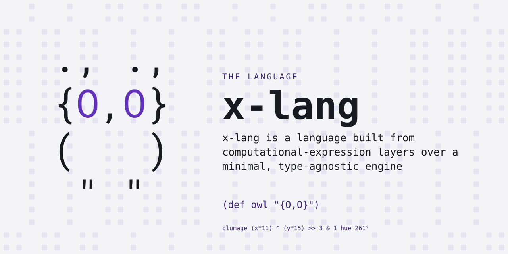

# x-lang

<p align="center"></p>

```
    ., .,
    {O,O}
    (   )
     " "
```

[](https://github.com/jonruttan/x-lang/actions/workflows/ci.yml)

**x-lang** is a system that hosts languages. Scheme, Kernel, Logo, a POSIX
shell, Python, awk and C each load as a library over a small fexpr core
that is never modified to make room for them. The core is an **engine**:
atoms, pairs, a runtime type system and fexpr evaluation. Everything above
it — the language semantics, standard library, object system, numeric
tower, JIT compiler and the toolchain — is written in x-lang.

s-expressions are the initial syntax. The reader is extensible, so a
hosted language brings its own.

## Install

```sh
curl -fsSL https://raw.githubusercontent.com/jonruttan/x-lang/main/bootstrap.sh | sh -s -- --install
```

This clones the repository, fetches the engine release this tree pins,
verifies it, and installs `x` under `~/.local` without sudo. It needs
`git`, `make` and a C compiler. Without `--install` it builds in the clone
and prints how to run it from there. The knobs (`X_REF`, `X_PREFIX`,
`X_SRC`) are in the header of [bootstrap.sh](bootstrap.sh).

**A prebuilt binary.** Each
[release](https://github.com/jonruttan/x-lang/releases) ships a relocatable
tarball for macOS on arm64 and Linux on x86-64
(`x-<tag>-<os>-<arch>.tar.gz`):

```sh
tar -xzf x-<tag>-<os>-<arch>.tar.gz
sha256sum -c x-<tag>-<os>-<arch>.tar.gz.sha256   # verify the download
x-<tag>/bin/x                                     # run it, or add bin/ to PATH
```

The tarball is the full install tree (wrapper, engine, library) under one
versioned directory. The wrapper finds its engine and library beside
itself, so it runs wherever it is unpacked. macOS release binaries are
Developer ID signed and notarized.

On any other platform, build from source: see [Build](#build).

## A taste

```sh
x                           # an interactive session
x -f program.x              # evaluate a file
x -q -c '(write (+ 1 2))'   # evaluate an expression
```

In a checkout that has not been installed, `sh x.sh` is the same command.

```x
; Values dispatch to their class, subject-last -- and a list is callable
("hello,world" split ",")      ; -> ("hello" "world")
((list 10 20 30) 1)            ; -> 20

; Fexprs at the core: op receives its arguments unevaluated,
; plus the caller's environment as e
(def my-quote (op (x) e x))
(my-quote (+ 1 2))             ; -> ('+ 1 2), the list unevaluated

; Every closure receives itself as argument 0 -- recursion needs no global name
(def fact (fn (self n) (if (= n 0) 1 (* n (self (- n 1))))))
(fact 20)                      ; -> 2432902008176640000

; The xenon dialect adds a full numeric tower with automatic promotion
(+ 1/3 1/6)                    ; -> 1/2
(* 1+2i 3+4i)                  ; -> -5+10i
```

More in [examples/](examples/) — start with the
[examples guide](examples/README.md), or run one directly with
`x -f examples/x/hello.x`.

## Languages on top

A **lang** is a surface language, or a tool with a language of its own,
implemented in x-lang and loaded as a library. Each lives in its own
repository and is acquired as a pinned, verified bundle:

```sh
x --install-lang https://github.com/jonruttan/x-logo/releases/latest/download/lang.pin.xon
x -l logo                   # REPL + viewer at http://localhost:8080
```

A lang without a release installs from its checkout: clone it and run
`make install`, which installs into the `x` on `PATH`.

**Languages**

| lang | is | release |
|---|---|---|
| [x-r5rs](https://github.com/jonruttan/x-r5rs) | R5RS Scheme | [latest](https://github.com/jonruttan/x-r5rs/releases/latest) |
| [x-r7rs](https://github.com/jonruttan/x-r7rs) | R7RS Scheme, on top of x-r5rs | [latest](https://github.com/jonruttan/x-r7rs/releases/latest) |
| [x-krn](https://github.com/jonruttan/x-krn) | Kernel, with `$vau` | [latest](https://github.com/jonruttan/x-krn/releases/latest) |
| [x-sweet](https://github.com/jonruttan/x-sweet) | SRFI-105/110 sweet-expressions | [latest](https://github.com/jonruttan/x-sweet/releases/latest) |
| [x-logo](https://github.com/jonruttan/x-logo) | Logo turtle graphics, with a live browser viewer | [latest](https://github.com/jonruttan/x-logo/releases/latest) |
| [x-python](https://github.com/jonruttan/x-python) | a Python 3 surface | unreleased |
| [x-ash](https://github.com/jonruttan/x-ash) | a POSIX shell, after ash | [latest](https://github.com/jonruttan/x-ash/releases/latest) |
| [x-awk](https://github.com/jonruttan/x-awk) | an awk: the language and the `x -l awk --` CLI | unreleased |
| [x-cc](https://github.com/jonruttan/x-cc) | a C compiler: its own code generator, linker and Mach-O and ELF writers, and an evaluator | unreleased |

**Tools**

| lang | is | release |
|---|---|---|
| [x-grep](https://github.com/jonruttan/x-grep) | a grep: BRE by translation, ERE native, `-F` on bytes | unreleased |
| [x-sed](https://github.com/jonruttan/x-sed) | a sed, on x-grep's regex layer | unreleased |
| [x-make](https://github.com/jonruttan/x-make) | a make: the portable core x-lang's own Makefiles use | unreleased |
| [x-coreutils](https://github.com/jonruttan/x-coreutils) | BusyBox's applets in one bundle, `sort` and `sha256sum` to `vi` | unreleased |
| [x-git](https://github.com/jonruttan/x-git) | a git, compared against git itself; its digests and compression are x-lang's | unreleased |
| [x-ssh](https://github.com/jonruttan/x-ssh) | an SSH: client, server, key tool, scp, SFTP and the agent, by OpenSSH's names | unreleased |
| [x-tmux](https://github.com/jonruttan/x-tmux) | a terminal multiplexer, after tmux: sessions, windows and panes on pseudo-terminals | unreleased |
| [x-browse](https://github.com/jonruttan/x-browse) | a terminal browser for Markdown and HTML, after lynx, links and w3m | unreleased |

**Games**

| lang | is | release |
|---|---|---|
| [x-infocom](https://github.com/jonruttan/x-infocom) | an Infocom Z-machine: plays story files, with the tools around one | unreleased |
| [x-chess](https://github.com/jonruttan/x-chess) | a chess engine: a game at the terminal and the Universal Chess Interface | unreleased |
| [x-roguelike](https://github.com/jonruttan/x-roguelike) | a roguelike: a data-driven dungeon crawl | unreleased |

A lang's version, and the x-lang release it is paired with, are in its own
`lang.xon`.

awk, grep, sed, make, the coreutils and cc are tools x-lang's own build
invokes. [The bootstrap tool closure](docs/bootstrap-closure.md) measures
how much of that build x-lang can now supply itself.

[x-os](https://github.com/jonruttan/x-os) is the langs as a system: the Linux
kernel, x and its langs and nothing else, with x-ash as the shell and
x-coreutils as its commands. It is a container, `docker run -it
jonruttan/x-os`, and a [bootable ISO
image](https://github.com/jonruttan/x-os/releases/tag/latest) for x86-64 and
arm64.

[The Lang Contract](docs/lang-contract.md) is the terms a lang is held to
and what it may rely on; [Crafting a Lang](docs/crafting-a-lang.md) is how
one is built. For the bundles present on disk,
[`tools/contract/langs.x`](tools/contract/langs.x) records each one's suite
counts and `make check-langs` holds them.

## Status

x-lang is a research and teaching vehicle for **layered language
construction**: an investigation of how much a minimal, type-agnostic fexpr
core can bootstrap without being modified. It is useful for reading or
borrowing a working design for extensible readers, fexpr evaluation, runtime
type systems and self-hosted toolchains. It is not trying to displace a
general-purpose application language.

**Maturity — [latest release](https://github.com/jonruttan/x-lang/releases/latest).**
The language and the xenon dialect are covered by a full spec suite, with CI
on macOS and Linux and a hard AddressSanitizer gate. The surface API is
*not* frozen and may change between versions. The radon dialect is
experimental.

## Features

- **Fexpr foundation** — All primitives receive unevaluated arguments. `fn` provides applicative semantics; `op` creates user-level fexprs with access to the caller's environment.
- **Adaptive type system** — Define new types at runtime with `make-type`. Each type carries dispatch methods for call, eval, write, read, convert, and more.
- **Object system** — Classes are callable values with message-passing dispatch (no quoting), single inheritance and `super`, encapsulated mutable fields, and a `(static …)` block for static methods and static fields — so a class doubles as a namespace. All in x-lang, on `make-type`.
- **Module system** — `provide`/`import` with deduplication. Modules are auto-discovered.
- **Numeric tower** — Arbitrary-precision integers, IEEE 754 floats, exact rationals, complex numbers, arbitrary-precision decimals with automatic promotion.
- **JIT compiler** — A data-driven assembler emits and runs native machine code on ARM64, x86-64 and 32-bit ARM, and a compiler lowers x-lang functions through it. No host toolchain is involved.
- **POSIX interface** — Fork, exec, pipe, dup2, wait, open, close, read, write, chdir, getenv, setenv via FFI.
- **Regular expressions** — Custom type with `#/pattern/` literal syntax.
- **Self-hosted tools** — Linter, formatter, coverage analyzer, profiler, and documentation generator written in x-lang.
- **Tail-call optimization** — Trampoline-based TCO with environment save/restore.
- **No third-party dependencies** — the engine reaches the host only through its CLI and its own system wrappers, and does no floating point; the full binary adds `-ldl` for `dlopen`/`dlsym`. Floats are x-lang's: the arithmetic is machine code the library's own assembler emits, and the math functions are `libm`'s, opened at runtime rather than linked.

## Architecture

The system is layered. Each layer expands capabilities without modifying those below it.

1. **Atom/pair bootstrap** (the engine) — One storage layout, two blessed lengths: every object is a fixed-size vector of slots, and the two smallest — the atom (one) and the pair (two) — are sufficient for evaluation and data construction. The evaluator dispatches through type methods, so these two suffice to get the system running.
2. **Adaptive type system** — Runtime type definitions with dispatch methods (call, eval, write, length, etc.). Types and the base object share the same nested-list contract structure, extensible by appending pairs.
3. **Modular library** (`lib/`) — modules organized by domain: core operations, custom types (vectors, strings, promises), a numeric tower (bigint, float, rational, complex, decimal), codecs, networking, system interfaces (POSIX, FFI, GC), self-hosted tools (linter, formatter, coverage, profiler, doc generator), and platform-specific code (ARM64, x86-64, 32-bit ARM).
4. **FFI and native code** — Dynamic library loading via `dlopen`/`dlsym`, calls through a pointer, raw pointer operations, and a JIT compiler that compiles x-lang functions to native machine code via a data-driven assembler.

See [docs/](docs/) for complete reference documentation.

### Engines

Layers 1 and 2 are the engine's, and the engine is not part of this
repository. It is acquired as a pinned, verified artifact and reached through
one path — the `engine` symlink — so nothing downstream names a particular
implementation.

- [**x-engine-c**](https://github.com/jonruttan/x-engine-c) — the C89 engine:
  evaluator, primitive surface, tokenizer. The reference implementation. This
  is what `make engine` fetches, and what
  [`tools/engine/engine.pin.xon`](tools/engine/engine.pin.xon) pins.
- [**x-engine-rust**](https://github.com/jonruttan/x-engine-rust) — a second
  engine, unreleased. Its core forbids `unsafe`; the foreign door is a
  separate crate.

What an engine must provide, promise and report is
[docs/engine-contract.md](docs/engine-contract.md). The conformance suite that
judges one lives here rather than in any engine, so that no implementation is
the arbiter the others are measured against.

## Dialects

The library is composed into dialects that control what capabilities are loaded:

- **helium** (`lib/he.x`) — The light dialect and the default (`lib/x.x` points to it). Combinators, list operations, sorting, strings, vectors, promises, quasiquote, the POSIX interface and a REPL. No numeric tower.
- **xenon** (`lib/xe.x`) — Stable full-stack dialect. Adds the numeric tower (bigint, float, rational, complex, decimal), regular expressions, `Dict` and `Set`, and the assembler and compiler, with the reader's analysers compiled to native code at boot.
- **radon** (`lib/rn.x`) — Experimental dialect. Everything in xenon plus the raw syscall surface, character constants, and I/O handle constants; file I/O and sockets load on demand (`(import x/sys/file)`, `x/platform/socket`).

Dialects are selected with the wrapper's `-l` flag, which also selects a
lang: `x -l xe`, `x -l r5rs`. [docs/dialects.md](docs/dialects.md) has the
detail.

## Build

This repository is the language. The engine is a separate project —
[x-engine-c](https://github.com/jonruttan/x-engine-c) — and is acquired
rather than carried:

```sh
git clone https://github.com/jonruttan/x-lang.git
cd x-lang
make engine     # fetch the release tools/engine/engine.pin.xon names, verified
make
```

`make engine` downloads the engine built for the platform, checks it against
the digest the pin records, and links it as `engine`. Prebuilt engines are
published for macOS on arm64 and Linux on x86-64. Two other routes:

```sh
make engine-source          # clone the pinned release and build it here
make X_ENGINE_DIR=../mine   # use an engine you already have
```

`make engine-source` is the route on a platform with no published engine
(arm64 Linux, 32-bit ARM), and for work on the engine itself. `make` alone,
in a tree that has never acquired one, prints these three options.

`make` points `engine` at the engine this tree builds against, builds it there
if it is a checkout, and copies the `x-bin` binary to this repo's root, where
the wrapper and every test runner expect to find it. A C compiler is needed
only when the engine is built from source.

`engine` is a symlink: everything downstream — the boot's contract includes,
the gates — names that one path, never a particular engine. Point it
somewhere else with `make X_ENGINE_DIR=/path/to/engine`, and the choice
holds until it is changed. The target may be a checkout (built here) or an
unpacked engine release (used as it comes).

One optional tool needs a host C toolchain when it runs: `x/tool/compile`,
the C-emitting compiler, invokes `cc` and `dlopen`s the result. Nothing else
does.

**Install from a checkout:**

```sh
make install                # /usr/local by default
make install PREFIX=~/.local
```

This installs the wrapper as `bin/x`, the engine binary under `libexec/x/`,
and the runtime tree under `share/x/`: the library and apps byte-identical to
the repo's, plus generated amalgamated boot entries under `share/x/boot/`, so
`x`, `x -l xe`, and `x -f program.x` work from any directory. `DESTDIR` is
honoured for staged and packaged installs. Remove with `make uninstall` (same
`PREFIX`).

## Run

```sh
x                           # helium (the default) + REPL
x -l xe                     # xenon: full-stack with numeric tower
x -l rn                     # radon: experimental
x -f program.x              # evaluate a file

# Evaluate an expression, or a program on stdin
x -q -c '(write (+ 1 2))'
echo '(write (+ 1 2))' | x -q
```

`-c/--eval` is repeatable and its expressions run in order, so a definition
and its use fit in one command; like `-f`, it exits when done. A
non-terminal stdin is program text. Nothing prints unless the program
prints: use `(write x)` for the machine-readable form and `(display x)` for
the human one.

Inside a session, `(help)` shows the documentation index; `(quit)` or ctrl-d
exits. The session has a built-in line editor: arrow keys, the readline
chords, history that persists across sessions, Tab completion over every
documented name, and colour applied as you type — see
[docs/repl.md](docs/repl.md).

`(apropos "split")` searches every documented name, `(help Str8/split)`
gives a signature with argument types and a runnable example, and
`(modules)` lists what is available — from a shell too, via `-c`.

A project can **pin** the library modules it depends on — keep the exact
files it was written against in its own tree and declare them in a
`pin.xon` manifest, which the wrapper finds beside the program (announced
on stderr; `--no-pin` skips). Walkthrough:
[docs/pinning-tutorial.md](docs/pinning-tutorial.md); reference:
[docs/modules.md](docs/modules.md), "Pinning".

## Test

```sh
make test-x                          # x-lang spec suite
make test-c                          # the engine's C unit tests (delegated)
make test                            # all tests
```

Test specs are markdown files in `tests/x/specs/` organized by category: core language, closures and applicatives, extensions (types, numeric tower, compile), standard library, end-to-end, and tools. CI runs the full suite on macOS and Linux, plus a hard AddressSanitizer gate.

`make test-c` delegates to the engine, and a fetched release ships no C to
test: it announces that it skipped and names what covers that ground instead.
The same is true of `check-isa`, `check-obj-layout` and `check-base-paths` —
[docs/contributing.md](docs/contributing.md) says which is which.

## Documentation

**Start here: [docs/index.md](docs/index.md)** — the documentation front
door. The whole of it, both generated references included, is published at
<https://jonruttan.github.io/x-lang/>. The [Glossary](docs/glossary.md)
defines the load-bearing terms (fexpr, operative, dialect, the base,
contract).

**Coding agents start at [AGENTS.md](AGENTS.md)** — the short briefing:
how to run it, the Lisp assumptions that fail here,
and the three calls that answer "what exists" without reading any of the
above. [llms.txt](llms.txt) is the machine-readable index of this list.

### Guides

- [Architecture](docs/architecture.md) — System design, evaluation model, the contract pattern
- [Type System](docs/type-system.md) — Objects, types, the base, dispatch, extensibility
- [Object System](docs/object-system.md) — Classes, instances, statics, inheritance, encapsulation
- [Dialects](docs/dialects.md) — the helium, xenon, and radon dialect layers
- [Tutorial](docs/tutorial.md) — Getting started guide
- [Modules](docs/modules.md) — The provide/import module system

### References

- [Specification](docs/spec.md) — Normative language specification
- [Glossary](docs/glossary.md) — Settled vocabulary and naming rulings
- [Syntax](docs/syntax.md) — Surface syntax rulings ([bare-core variant](docs/syntax-bare.md))
- [Primitives and core forms](docs/primitives.md) — the engine's instruction set, the coordinates reached through `prim-ref`, and the operatives and procedures that boot on top
- [Standard Library](docs/standard-library.md) — how the library is laid out and how to find a name in it
- [x-lang API Reference](https://jonruttan.github.io/x-lang/docs/ref/x/index.html) — every module, generated from the `(doc ...)` forms (offline: `make doc-x`, then `docs/ref/x/index.md`)
- [C API Reference](https://jonruttan.github.io/x-lang/docs/ref/c/html/index.html) — the C engine, generated by Doxygen (offline: `make doc-c`, then `docs/ref/c/html/index.html`)

### Tools

- [Dev tools](tools/dev/README.md) — Formatter, linter, coverage, benchmarks, doc generation

## Licence

[MIT No Attribution (MIT-0)](LICENSE)

<p align="center"></p>
